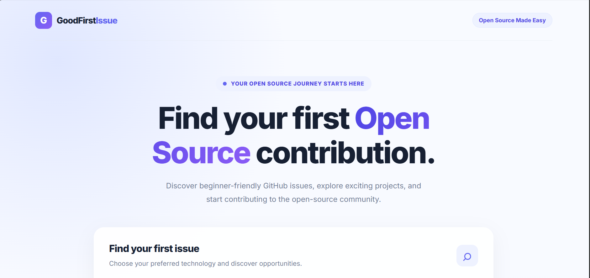
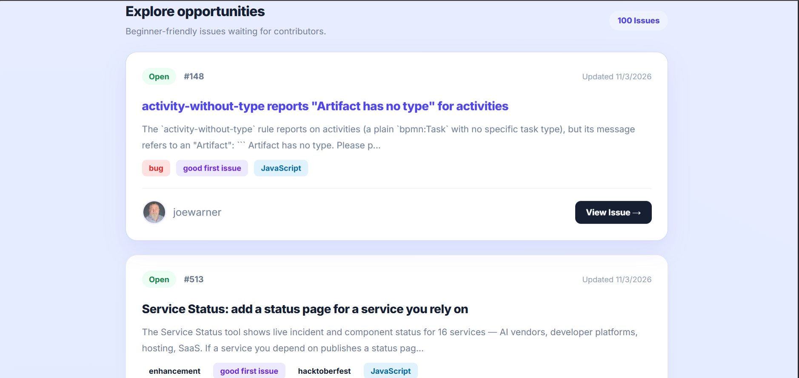

# 🔎 Good First Issue Finder

Find beginner-friendly GitHub issues and start your open-source journey!

Good First Issue Finder is a simple web application that helps beginners discover open GitHub issues labeled **good first issue**. Choose a programming language, search, and explore real opportunities to contribute to open-source projects.

## Live Demo 

 [View Live Site](https://itsrazakhan.github.io/good-first-issue-finder)

## ✨ Features

- 🔍 Search beginner-friendly GitHub issues.
- 💻 Filter issues by programming language.
- 🌐 Fetch real-time data using the GitHub REST API.
- 🏷️ Display issue labels and programming languages.
- 👤 Show contributor usernames and profile links.
- 🔗 Open original GitHub issues directly.
- 📅 Display issue update dates.
- ⚡ Dynamically generate issue cards.
- 📱 Responsive and user-friendly interface.
- ⚠️ Handle loading states, empty results, and API errors.

## 🛠️ Technologies Used

- HTML5
- CSS3
- JavaScript (Vanilla JS)
- GitHub REST API

## 📸 Screenshots




## 🚀 Getting Started

### 1. Clone the repository

```bash
git clone https://github.com/itsrazakhan/good-first-issue-finder.git
```

### 2. Open the project folder

```bash
cd good-first-issue-finder
```

### 3. Run the project

Open `index.html` in your browser.

No installation or API key is required for the basic version.

## 🔗 GitHub API

This project uses the GitHub Search Issues API:

https://api.github.com/search/issues

It searches for open issues with the `good first issue` label and filters results by the selected repository language.

## 📂 Project Structure

```text
good-first-issue-finder/
│
├── index.html
├── style.css
├── script.js
├── README.md
├── LICENSE
│
└── images/
    └── Capture.png
    │
    └── Capture1.png
```

## 🎯 Project Goal

The goal of this project is to make open-source contribution easier for beginners by helping them find real beginner-friendly issues without manually searching through hundreds of GitHub repositories.

## 🔮 Future Improvements

- [ ] Add pagination.
- [ ] Add a Load More button.
- [ ] Search by repository name.
- [ ] Add difficulty filters.
- [ ] Add issue sorting options.
- [ ] Display repository names and star counts.
- [ ] Add dark mode.
- [ ] Add more advanced search filters.

## 🤝 Contributing

Contributions are welcome!

If you have ideas for improving this project:

1. Fork this repository.
2. Create a new branch.
3. Make your changes.
4. Submit a pull request.

## 👨‍💻 Author

**Raza Khan**

- GitHub: [@itsrazakhan](https://github.com/itsrazakhan)

---

⭐ If you find this project useful, consider giving it a star!

**Made with ❤️ to help beginners contribute to open source.**
